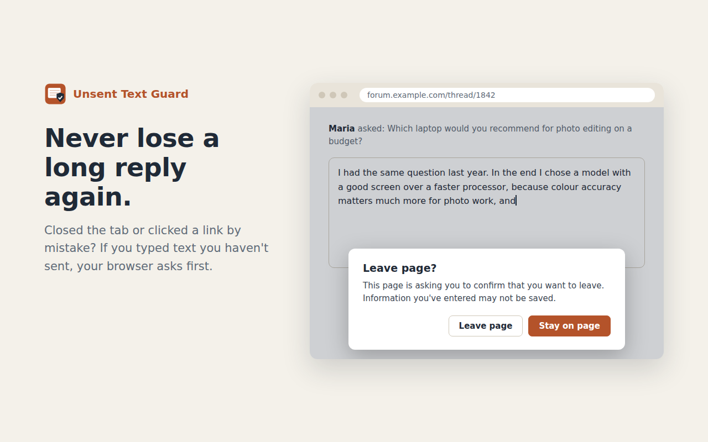

# Unsent Text Guard

Never lose a long comment, reply or form answer again. Unsent Text Guard warns you before you close, reload or leave a page where you typed text you haven't sent. Text the website filled in by itself is ignored.



## Install

- **Firefox:** coming soon
- **Microsoft Edge:** coming soon
- **Chrome:** coming soon

## How it works

- **Only your typing counts.** When you press your first key in a text box, the extension remembers what the box already contained. Only the text you add after that counts. Text from the page's HTML, text set by the site's JavaScript, browser autofill and restored drafts never trigger a warning.
- **Short typing is ignored.** By default at least 20 typed characters (spaces not counted) are needed. You can change this in the popup.
- **Sent text isn't guarded.** Submitting a form counts as sending. If the site clears or removes the box after posting (chats, comments), the text no longer counts.
- **Password fields are ignored.**
- **Your control:** the toolbar popup shows how many boxes on the page have unsent text, and turns the guard off for the current site.

The warning is the browser's own "Leave page?" dialog. Browsers don't let extensions change its text.

**Known limitations:** some web apps switch views without leaving the page, so the browser gives no chance to warn. On Firefox for Android, closing a tab from the tab list may not show the warning.

## Privacy

Your text never leaves the page and is never stored. See [PRIVACY.md](PRIVACY.md).

## Project structure

```
src/                 shared code for every browser
  content.js         runs on each page: tracks typed text, shows the warning
  popup.html/.js     toolbar popup and settings
platform/
  chrome/            Chrome + Edge (Manifest V3): manifest.json
  firefox/           Firefox (Manifest V2): manifest.json
store/               store images
build.sh, build.ps1  build scripts
```

## Build

macOS / Linux:

```sh
./build.sh
```

Windows (PowerShell):

```powershell
powershell -ExecutionPolicy Bypass -File .\build.ps1
```

Both create `dist/` with an unpacked folder and a store-ready zip for each browser. Keep the `version` in both manifests the same; the build stops if they differ.

## Test locally

- **Firefox:** open `about:debugging` → **This Firefox** → **Load Temporary Add-on…** → pick `dist/firefox/manifest.json`.
- **Chrome / Edge:** open `chrome://extensions` or `edge://extensions` → turn on **Developer mode** → **Load unpacked** → pick `dist/chrome-edge`.
- **Quick check:** open a page with a text box, type a sentence of 20+ characters, then try to close the tab. The browser should ask before closing.
- **Check the Firefox build:** `npx web-ext lint --source-dir dist/firefox`

## License

[MIT](LICENSE) © Ehsan Shariaty · [grizzly.ir](https://grizzly.ir)
